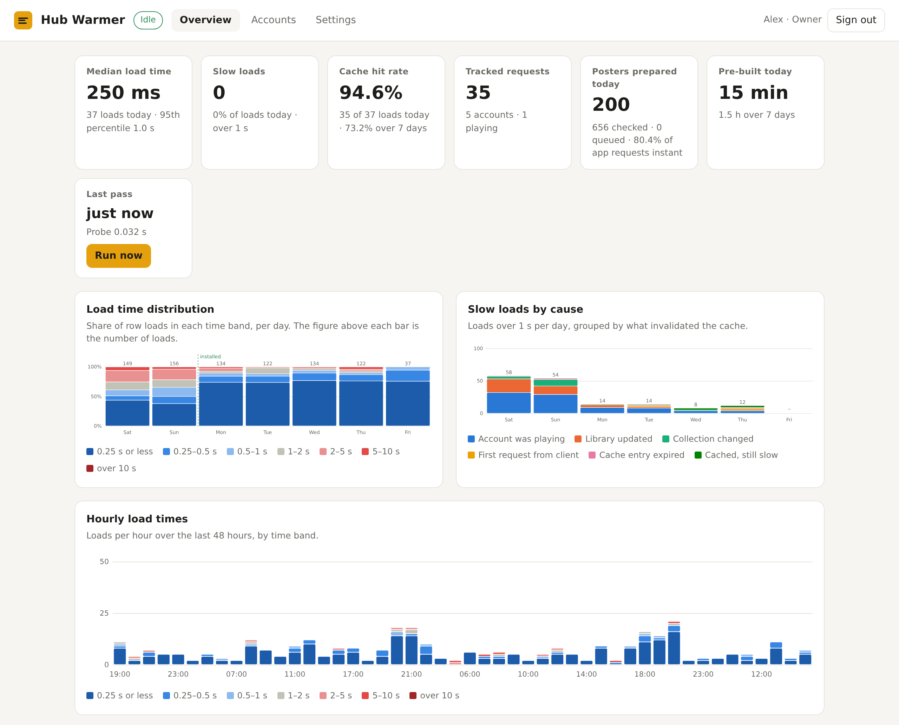
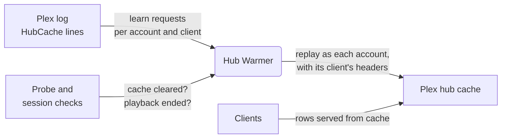
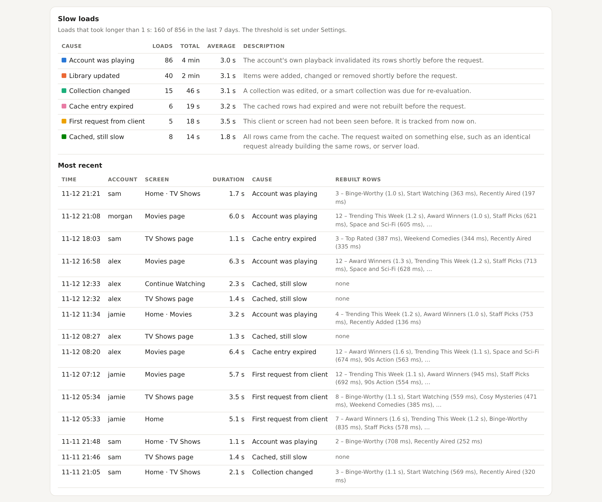
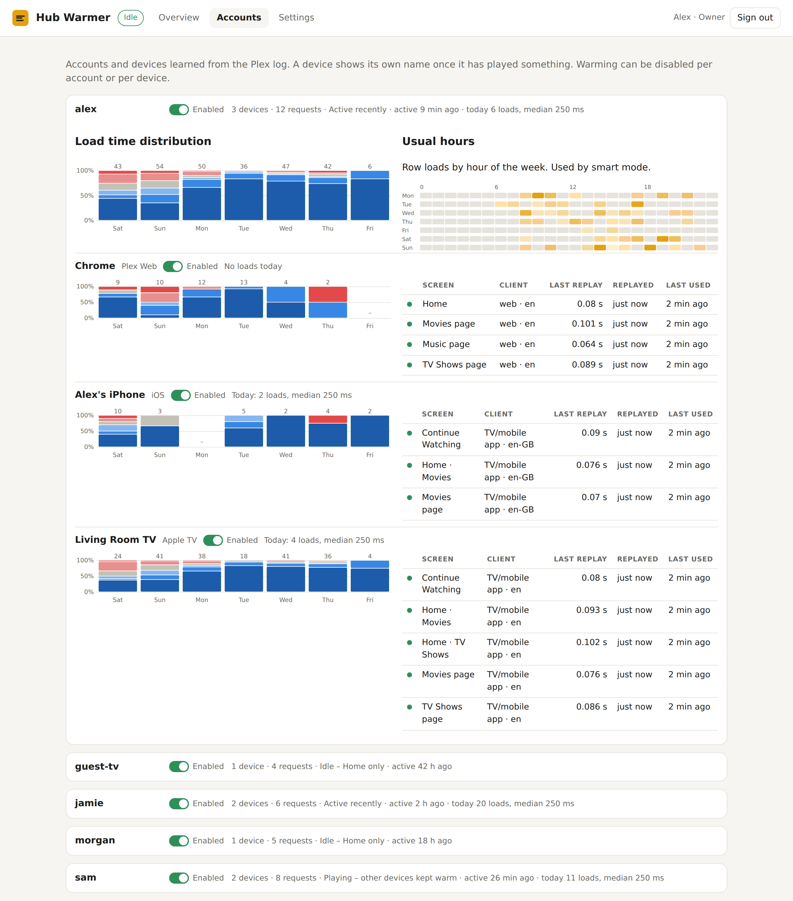
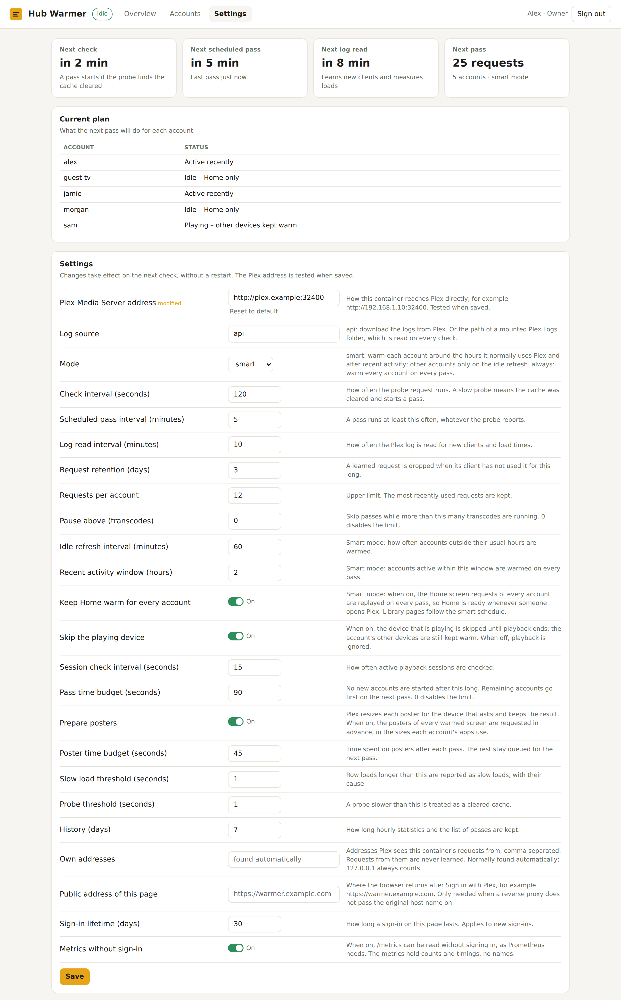
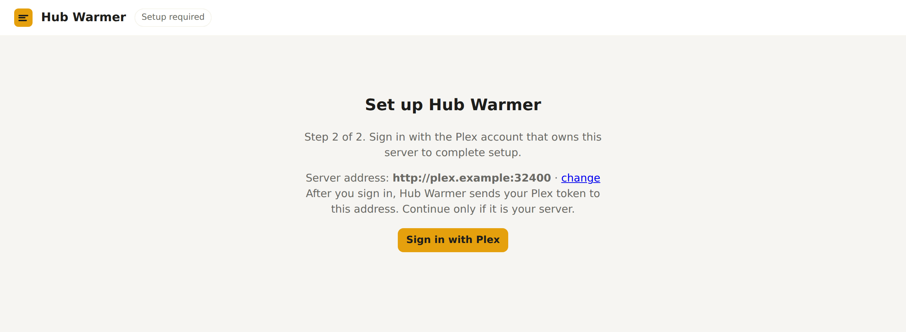
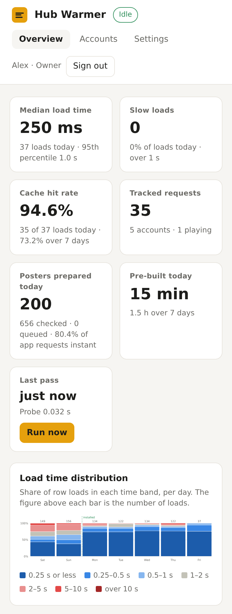

# Hub Warmer

On a Plex server with many collection rows, the Home screen and library pages can take several seconds to
open. Plex builds each row on request and keeps the result in a cache, and that cache is cleared whenever the
library changes, whenever an account plays something, and after a day without use. The next person to open the
app waits while every row is rebuilt.

Hub Warmer keeps those rows in Plex's cache, for every account and every device that uses the server, so the
screens open without the wait.



The screenshots on this page show invented demo data.

An independent project, with no affiliation to or endorsement by Plex.

## Contents

- [The problem](#the-problem)
- [What it does](#what-it-does)
- [How it works](#how-it-works)
- [What to expect](#what-to-expect)
- [Requirements](#requirements)
- [Installation](#installation)
- [Web interface](#web-interface)
- [Screenshots](#screenshots)
- [Metrics](#metrics)
- [Modes and scheduling](#modes-and-scheduling)
- [Settings](#settings)
- [FAQ](#faq)
- [Limitations](#limitations)
- [Security](#security)
- [Development](#development)
- [License](#license)

## The problem

Plex builds each row on the Home screen and on library pages on request. "Recently Added", "Continue Watching"
and every pinned collection ("hubs") is one or more database queries. A page with many collection rows, as
created by Kometa, Agregarr or Plex's own recommendations, can take several seconds to build.

Plex caches the built rows, but the cache is narrow and short-lived:

- An entry belongs to one account and one exact request, including the device's language and feature flags.
  A television, a phone and a browser on the same account each have their own entries.
- Entries are discarded when the library changes (new items, metadata refreshes, collection edits), when the
  account's own playback state changes, and after 24 hours without use.

After entries are discarded, the next person to open that page waits while every row is rebuilt.

On the reference server, with two dozen collection rows, the Movies page took
4.5–9 seconds to load whenever its cache entries had been discarded. A page whose rows are cached typically
loads in 0.1–0.5 seconds.

## What it does

Hub Warmer runs as a small container next to Plex Media Server. It needs no Plex plugin, makes no changes to
the library, and needs no configuration per user or device. It does three things:

- **Keeps the rows cached.** It learns which screens each account's devices open, and has Plex rebuild them
  whenever the cache is cleared, before anyone opens the app.
- **Prepares the posters.** It requests the poster images of every warmed screen in advance, in the sizes each
  device uses, so the pictures are ready as well.
- **Measures real load times.** A web page shows how long Home and library pages take for real users, how often
  they come from cache, and the cause of every slow load.

### Warming

- **Learns each device by itself.** It reads Plex's debug log to find the requests each account's devices make.
  A new device is picked up the first time it is used.
- **Detects a cleared cache.** A probe request every two minutes shows whether Plex has cleared its cache, and
  a warming pass starts when it has.
- **Rebuilds the rows as each account.** It repeats every learned request as that account, with that device's
  headers, so Plex fills the same cache entries the device will read.
- **Follows playback.** Plex discards an account's rows while it is watching. The device that is playing is
  skipped until playback ends, and is then warmed first. The account's other devices stay warm.
- **Works to a schedule.** In smart mode, Home is kept warm for every account on every pass. Library pages are
  warmed during the hours each account normally uses Plex, learned per hour of the week, and for two hours
  after any activity.
- **Limits its own load.** Requests are sent one at a time, each pass has a time budget, and passes can be
  paused while transcodes are running.

### Reporting

- **Load times for real users.** Median and 95th-percentile load time, the share of loads served from cache,
  and the distribution per day and per hour.
- **Every slow load with its cause.** Each load over the threshold is listed with the account, the screen, the
  duration, why the cache was empty (the account was playing, the library was updated, a collection changed)
  and the rows Plex had to rebuild.
- **The cost of each row.** How long Plex takes to build each row, which shows the collections that slow
  every uncached load.
- **Accounts and devices.** Each device with its own load times and tracked screens. Warming can be switched
  off per account or per device.
- **Metrics.** Prometheus metrics and a Grafana dashboard for the same figures.

The server owner signs in with Plex and sees everything. Accounts the server is shared with see the overall
figures and their own devices.

### When it helps

Hub Warmer is most useful on a server with several collection or recommendation rows, a library that changes
often, or many accounts and devices. A server whose Home and library pages already load quickly has no need
for it.

## How it works

1. **Learn.** The warmer reads Plex's debug log to find which row requests each account's clients make. No per-user or per-device configuration is needed; a client is picked up the first time it is used.
2. **Detect.** A probe request every two minutes shows whether Plex has cleared its cache. Active playback sessions are checked every 15 seconds.
3. **Replay.** When the cache has been cleared, and on a regular schedule, the warmer repeats each learned request as that account, with that client's headers, so Plex rebuilds the rows before anyone asks for them.



4. **Posters.** Plex resizes each poster for the device that asks and keeps the result. The warmer requests the posters of every warmed screen in advance, in the form each account's apps use, so the images are ready too.

[docs/how-it-works.md](docs/how-it-works.md) describes the cache key, the log lines and each step in detail.

## What to expect

A page whose rows are cached typically loads in 0.1–0.5 seconds. The warmer increases how often that is the case; it does not make uncached rows faster to build.

Not every load can be served from cache:

- During playback Plex discards the watching account's rows every few seconds. The warmer rebuilds them when playback ends, but a page opened in the first seconds after stopping can still be uncached.
- The first request from a new client is never cached. The client is learned from that request.

The web interface reports the cache hit rate for real loads, lists each slow load with its cause, and shows how long Plex takes to build each row. If a few rows account for most of the build time, removing or replacing them improves every uncached load.

The warmer is most useful when a server has several collection or recommendation rows, a library that changes often, or many accounts and devices. If the Home screen and library pages already load quickly, it is not needed.

## Requirements

- Plex Media Server with debug logging enabled: Settings → General → Enable Plex Media Server debug logging. The warmer learns from these log lines and the web interface shows a warning if they stop.
- A direct network connection from the container to Plex.
- One sign-in by the server owner on the warmer's web page.

## Installation

### Docker Compose

```yaml
services:
  hub-warmer:
    image: ghcr.io/quinneydavid/hub-warmer:latest
    container_name: hub-warmer
    restart: unless-stopped
    ports:
      - "8080:8080"
    environment:
      TZ: Europe/London        # time zone of the Plex server, for its log timestamps
    volumes:
      - hub-warmer:/data

volumes:
  hub-warmer:
```

The container runs as user 1000. With a folder instead of a named volume (`./hub-warmer:/data`), give that user the folder first: `mkdir hub-warmer && sudo chown 1000:1000 hub-warmer`.

Open `http://<host>:8080`. Setup has two steps, both on the page:

1. Enter the address of the Plex Media Server, for example `http://192.168.1.10:32400`. The address is tested before it is stored.
2. Choose **Sign in with Plex**, using the account that owns the server.

The warmer then learns requests from the Plex log and starts its first pass within a few minutes. No other configuration is needed; everything else is on the Settings page.

The [`examples/`](examples/) folder has equivalents for `docker run`, Kubernetes and Unraid.

## Web interface

Access requires Sign in with Plex. The server owner sees everything. Accounts the server is shared with see the overall figures and their own devices. All other accounts are refused.

**Overview**

- Median and 95th-percentile load time, number of slow loads, cache hit rate, tracked requests and time spent pre-building rows.
- Load time distribution per day and per hour, in seven bands from under 0.25 s to over 10 s.
- Slow loads per day by cause, and a table of each recent slow load with the account, screen, duration, cause and the rows Plex rebuilt. A load is slow when it exceeds the slow load threshold (Settings).
- Load times per screen (Home, each library page, Continue Watching).
- Row build cost: the average and maximum time Plex takes to build each row.
- Posters: poster requests from real apps per day and the share Plex answered at once, next to the number of posters the warmer checked and prepared.
- Warmer activity per hour and the most recent passes.

**Accounts**

Each account and device with its tracked requests and load time distribution. Devices are identified and named from Plex's own device list and per-device traffic statistics, so several devices behind one address are kept apart. Warming can be disabled per account or per device.

**Settings**

The schedule, the plan for the next pass, and every setting: the Plex address, the log source, modes, intervals and limits. Changes apply on the next check, without a restart.

## Screenshots

All screenshots show demo data: the server, accounts and devices are invented.

| | |
|---|---|
| [](docs/screenshots/slow-loads.png) | [](docs/screenshots/accounts.png) |
| Overview: slow loads by cause, and each recent slow load with the rows Plex rebuilt. | Accounts: each device with its load times and tracked requests. |
| [](docs/screenshots/settings.png) | [](docs/screenshots/setup.png) |
| Settings: the schedule, the plan for the next pass and every setting. | First run: after the address is entered, the owner signs in with Plex. |



The Overview page on a phone.

## Metrics

- `/metrics` exposes Prometheus metrics with the prefix `hub_warmer_`. They include a histogram of real load times (`user_row_load_seconds`), the cache hit rate for real loads (`user_row_cache_requests_total`, `user_row_cache_hits_total`), slow loads by cause (`user_slow_loads_total`), and the warmer's own activity. Labels contain no account names.
- Plex's own hub cache hit ratio is exported as `hub_warmer_plex_hubcache_hit_ratio`. It includes the warmer's requests, so it overstates the hit rate for real loads.
- [`grafana/hub-warmer.json`](grafana/hub-warmer.json) is a Grafana dashboard for these metrics.
- `/api/status` returns the web interface's data as JSON. `/healthz` is for health checks.

## Modes and scheduling

- **smart** (default). The Home screen requests of every account are replayed on every pass, so Home is cached whenever someone opens Plex. Library pages are replayed on every pass during the hours an account normally uses Plex, learned per hour of the week, and for two hours after any activity; outside those times, once an hour.
- **always**. Every account is warmed on every pass. On a server with many accounts, most of this work is for accounts that are not in use.

In both modes:

- Playback is tracked per device. The device that is playing is skipped until playback ends or is paused, and is then warmed first. The account's other devices are still kept warm, because people browse on a second device, or share an account, while something plays.
- A pass has a time budget of 90 seconds. Accounts are ordered by urgency (playback ended, recently active, usual hours, idle); accounts that do not fit go first on the next pass.
- Passes can be paused while more than a set number of transcodes are running.

## Settings

All settings are on the Settings page, which only the server owner can open. They are stored in `/data` and take effect on the next check.

The page also covers what used to need environment variables: the Plex Media Server address (tested when saved), the log source (`api`, or the path of a mounted Plex `Logs` folder), the public address of the page for the sign-in redirect behind a reverse proxy, own addresses, history length, sign-in lifetime and whether `/metrics` needs a sign-in. Warming is switched on or off per account and per device on the Accounts page.

### Start-up options

These options are read from the environment when the container starts, because they are needed before the page exists or decide who may open it. None is required.

| Variable | Default | Description |
|---|---|---|
| `DATA_DIR` | `/data` | Where learned requests, history, settings and the owner token are kept |
| `WEB_PORT` / `WEB_BIND` | `8080` / `0.0.0.0` | Where the page and metrics listen. `WEB_PORT=0` disables both |
| `WEB_AUTH` | `plex` | `plex` requires Sign in with Plex. `none` disables sign-in; use it only behind an authenticating proxy |
| `PLEX_TOKEN` | – | Owner token for running without a sign-in (headless, or with `WEB_AUTH=none`) |
| `PLEX_PREFERENCES` | `/plex/Preferences.xml` | Used only when no owner has signed in and `PLEX_TOKEN` is empty: a mounted Plex `Preferences.xml` to read the server's token from |

`TZ` sets the container's time zone and should match the Plex server's.

### Optional defaults

Every setting on the page also has an environment variable that sets its default, for deployments that are configured as code. A value saved on the page takes precedence.

| Variable | Default | Description |
|---|---|---|
| `PLEX_URL` | – | Address of the Plex Media Server. When set, step 1 of setup is skipped |
| `PLEX_LOGS` | `api` | `api` downloads the logs through Plex (`/diagnostics/logs`). Alternatively, the path of a mounted Plex `Logs` folder |
| `WARM_MODE` | `smart` | `smart` or `always` |
| `INTERVAL_SECONDS` | `120` | Interval between probe requests |
| `TOP_UP_MINUTES` | `5` | Maximum time between passes |
| `LEARN_MINUTES` | `10` | Interval between reads of the Plex log |
| `KEEP_DAYS` | `3` | A learned request is dropped after this many days without use |
| `MAX_REQUESTS_PER_ACCOUNT` | `12` | Limit per account. The most recently used requests are kept |
| `HOME_ALWAYS` | `1` | Smart mode: replay every account's Home screen requests on every pass. `0` limits idle accounts to the hourly refresh |
| `SKIP_WHILE_PLAYING` | `1` | Skip an account during playback and warm it when playback ends. `0` disables this |
| `SESSION_POLL_SECONDS` | `15` | Interval between checks of active playback sessions |
| `PASS_BUDGET_SECONDS` | `90` | Time budget per pass. `0` disables the limit |
| `WARM_POSTERS` | `1` | Request the posters of every warmed screen in advance, in the sizes each account's apps use. `0` turns it off; on the Settings page it is an on/off switch |
| `POSTER_BUDGET_SECONDS` | `45` | Time spent on posters after each pass |
| `SLOW_LOAD_SECONDS` | `1.0` | Row loads longer than this are reported as slow loads |
| `PROBE_SLOW_SECONDS` | `1.0` | Smart mode: a probe request slower than this means the rows were dropped, and a pass starts |
| `PAUSE_ABOVE_TRANSCODES` | `0` | Skip passes while more than this many transcodes are running. `0` disables the limit |
| `SMART_IDLE_MINUTES` | `60` | Smart mode: interval for accounts outside their usual hours |
| `SMART_RECENT_HOURS` | `2` | Smart mode: accounts active within this window are warmed on every pass |
| `HISTORY_DAYS` | `7` | How long hourly statistics and the list of passes are kept |
| `SELF_IPS` | – | Additional addresses whose requests are ignored. The warmer's own address is detected automatically |
| `PUBLIC_URL` | – | External URL of the page when it is behind a reverse proxy. Used for the sign-in redirect |
| `SESSION_DAYS` | `30` | How long a sign-in on the page lasts |
| `METRICS_PUBLIC` | `true` | Serve `/metrics` without sign-in |

## FAQ

**Does it change anything in Plex?**
No. It sends the same read requests that clients send. It does not edit the library, collections or settings, and it does not start playback, so it does not appear in watch history or in Tautulli.

**Why is debug logging required?**
Plex's cache key includes request headers (language and feature flags) that appear only in the debug log. Without them the warmer would fill cache entries that no client reads.

**How are other accounts' tokens handled?**
To request an account's rows, the warmer must ask Plex as that account. It obtains the server access tokens for shared accounts from plex.tv, which is the list Plex's own sharing uses. They are held in memory only and are never written to disk, logged or displayed.

**How much load does it add?**
A replay of a cached request takes a few milliseconds. A replay of an uncached request makes Plex do the work it would otherwise do when the page is opened. Requests are sent one at a time. The Overview page shows the time spent per hour.

**Does it affect search, artwork or item pages?**
No. It covers Home and library rows only.

**Why is a new device slow the first time?**
A client is learned from its first requests. It is included from the next pass.

## Limitations

- The warmer depends on the format of Plex's cache key and log lines, which are undocumented. A Plex update may change them. The web interface and the `debug_logging_ok` metric indicate when learning stops.
- Managed Plex Home users without their own Plex account are not covered.
- Only the owner and accounts the server is shared with are covered.

## Security

See [SECURITY.md](SECURITY.md). Run the warmer on a local network or behind a reverse proxy with HTTPS. The owner token is stored only in `/data` with file mode 600. Tokens for shared accounts are kept in memory only.

## Development

The warmer uses the Python standard library only (3.12 or newer).

```sh
python3 -m unittest discover -s tests                      # tests
DATA_DIR=./data WEB_AUTH=none PLEX_TOKEN=... python3 -m hubwarmer   # run locally, then open http://localhost:8080
```

To try the page without a Plex server, run the demo. It starts Hub Warmer against a fake Plex server with invented accounts and a week of history ([`tools/demo/`](tools/demo/)); nothing leaves the machine.

```sh
python3 tools/demo/run.py              # then open http://localhost:8099
python3 tools/demo/screenshots.py      # regenerate docs/screenshots (needs: pip install playwright pillow)
```

Changes are listed in [CHANGELOG.md](CHANGELOG.md).

## License

MIT. See [LICENSE](LICENSE).

Hub Warmer is an independent project. It is not affiliated with or endorsed by Plex, Inc. "Plex" and "Plex Media Server" are trademarks of Plex, Inc.
